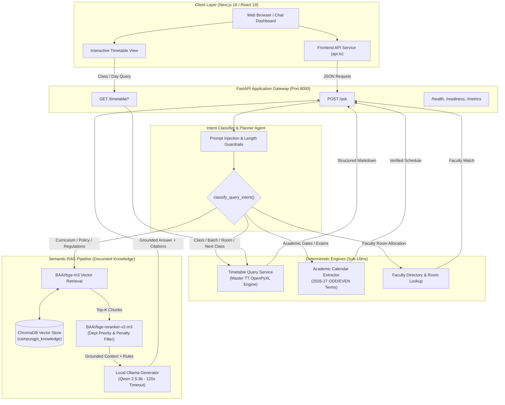
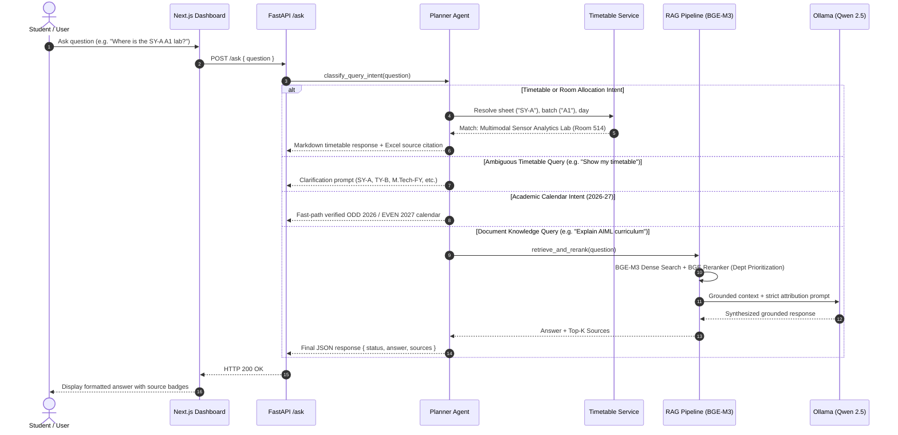

# CampusGPT

<div align="center">

[](https://www.python.org/)
[](https://fastapi.tiangolo.com/)
[](https://nextjs.org/)
[](https://react.dev/)
[](https://tailwindcss.com/)
[](https://www.trychroma.com/)
[](https://ollama.ai/)
[](https://huggingface.co/BAAI/bge-m3)

<p align="center">
  <b>Enterprise-Grade Local Campus AI Assistant: Hybrid Semantic RAG, Multi-Agent Intent Planner & Deterministic Timetable Engine</b>
</p>

[Local Frontend](http://localhost:3000) • [Local API Docs](http://localhost:8000/docs) • [FastAPI Health](http://localhost:8000/health) • [Prometheus Metrics](http://localhost:8000/metrics) • [GitHub Repository](https://github.com/Pankaj429w63/CampusGPT)

</div>

---

## Overview

**CampusGPT** is an intelligent university campus assistant combining modern generative AI with deterministic domain engines. It serves students, faculty, and administrators with instant, grounded answers across institutional handbooks, course curricula, academic calendars, faculty directories, and live class timetables without hallucination or cross-department confusion.

### Key Capabilities
- **Hybrid Multi-Agent Planner:** Automatically routes user queries between deterministic tools (academic calendar, class timetable, faculty room lookup) and a dense semantic RAG pipeline.
- **Deterministic Structured Timetable Engine:** Direct OpenPyXL parser for complex 13-worksheet master schedules, merged cells, concurrent laboratory batches, and room allocations with sub-10ms latency (zero ChromaDB overhead).
- **Domain-Aware Semantic RAG:** Deep document chunking with hierarchical section preserving, powered by `BAAI/bge-m3` dense embeddings, `BAAI/bge-reranker-v2-m3` cross-encoders, and ChromaDB vector store.
- **Hallucination & Attribution Guardrails:** Department-isolated cross-penalties, prompt injection firewalls, and out-of-domain refusals.
- **Full-Stack Production Ready:** Responsive Next.js 16 (Turbopack) UI with real-time thinking states and markdown formatting paired with an asynchronous FastAPI backend.

---

## System Architecture



---

## Detailed Data & Routing Flow



---

## Models & Technology Stack

| Component | Technology / Model | Identifier / Link | Role |
| :--- | :--- | :--- | :--- |
| **LLM Inference** | Qwen 2.5 (3B Parameters) | [`qwen2.5:3b`](https://ollama.ai/library/qwen2.5) | Local private answer synthesis via Ollama |
| **Dense Embeddings** | BAAI BGE-M3 | [`BAAI/bge-m3`](https://huggingface.co/BAAI/bge-m3) | 1024-dim multilingual semantic embeddings |
| **Neural Reranker** | BAAI BGE Reranker v2 M3 | [`BAAI/bge-reranker-v2-m3`](https://huggingface.co/BAAI/bge-reranker-v2-m3) | Cross-encoder reranking with department prioritization |
| **Vector Database** | ChromaDB | [`chromadb`](https://www.trychroma.com/) | Persistent local embeddings collection (`campusgpt_knowledge`) |
| **Backend Framework** | FastAPI + Uvicorn | Python 3.12 | Async REST API, Pydantic schemas, Prometheus metrics |
| **Frontend Framework** | Next.js 16 + React 19 | Turbopack | Modern glassmorphism UI, real-time chat, responsive views |
| **Workbook Parser** | OpenPyXL | Python | Deterministic multi-sheet Excel timetable engine |

---

## Live Endpoints & Port Map

| Service / Port | URL | Description |
| :--- | :--- | :--- |
| **Frontend Application** | `http://localhost:3000` | Interactive Chat and Timetable Dashboard |
| **Backend REST API** | `http://localhost:8000` | Application Root |
| **Interactive API Docs** | `http://localhost:8000/docs` | Swagger UI documentation and testing |
| **Backend Health Check** | `http://localhost:8000/health` | Service health status |
| **Backend Readiness** | `http://localhost:8000/readiness` | Deep readiness check (Ollama + Vector Store + Documents) |
| **Prometheus Metrics** | `http://localhost:8000/metrics` | Latency and tool call telemetry |
| **Timetable Sheets API** | `http://localhost:8000/timetable/sheets` | List all available classes |
| **Class Timetable API** | `http://localhost:8000/timetable/class/{sheet}` | Query day/batch schedule for section |
| **Timetable Search API** | `http://localhost:8000/timetable/search` | Search by faculty, subject code, or room |

---

## Quickstart Guide

### 1. Prerequisites
- **Python 3.11+** (Python 3.12 recommended)
- **Node.js 18+** & **pnpm 10+**
- **Ollama** installed with `qwen2.5:3b` pulled:
  ```bash
  ollama pull qwen2.5:3b
  ```

### 2. Backend Setup
```powershell
# Navigate to repository root
cd CampusGPT

# Create and activate virtual environment
python -m venv backend/.venv
.\backend\.venv\Scripts\Activate.ps1

# Install backend dependencies
pip install -r backend/requirements.txt

# Start FastAPI Server
$env:PYTHONPATH="backend"
python -m uvicorn app.main:app --host 127.0.0.1 --port 8000 --reload
```

### 3. Frontend Setup
```powershell
# Navigate to frontend
cd frontend

# Install dependencies
pnpm install

# Start Next.js Development Server
pnpm dev
```
Open **[http://localhost:3000](http://localhost:3000)** in your browser.

---

## Verification & Testing Suite

CampusGPT includes comprehensive test suites across agents, RAG, and timetable modules:

```powershell
# Run full backend test suite (55 tests)
$env:PYTHONPATH="backend"
pytest backend/tests -v

# Run frontend linting & TypeScript type checks
cd frontend
pnpm lint
pnpm tsc --noEmit

# Test production build
pnpm build
```

---

## Repository Safety & Data Governance

- **Institutional Privacy:** Original PDF handbooks, Master Excel files (`data/`), and local vector stores (`backend/data/`) are strictly excluded via `.gitignore`.
- **Zero Hallucination Attribution:** Strict negative penalties prevent coordinators of other departments from being classified as AIML faculty.
- **Zero Mock Fallback:** All chat endpoints resolve against live backend knowledge or deterministic timetable parsers.

---

<div align="center">
  <b>CampusGPT</b> • Engineered for Accuracy, Reliability & Academic Integrity.
</div>

